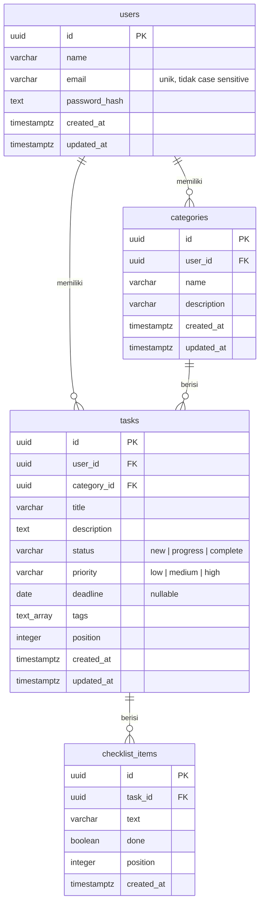

# Desain Database

Database memakai PostgreSQL dengan SQL murni (tanpa ORM). Semua primary key berupa UUID yang dibuat oleh `gen_random_uuid()`.

## Diagram Relasi

## Tabel

### `users`

Menyimpan akun. Password disimpan sebagai hash bcrypt, tidak pernah dalam bentuk asli. Index unik `users_email_unique` dibuat di atas `lower(email)`, sehingga `Andri@Mail.com` dan `andri@mail.com` dianggap email yang sama.

### `categories`

Setiap kategori dimiliki satu user. Menghapus user akan menghapus seluruh kategorinya (`ON DELETE CASCADE`).

### `tasks`

Kolom penting:

- **`status` dan `priority`** dibatasi dengan `CHECK` constraint, jadi nilai di luar daftar ditolak oleh database walaupun lolos dari aplikasi.
- **`deadline`** bertipe `DATE`, bukan `TIMESTAMPTZ`, karena deadline adalah tanggal kalender. Driver `pg` dikonfigurasi agar mengembalikan `DATE` sebagai string `YYYY-MM-DD`, sehingga tidak bergeser satu hari akibat konversi zona waktu.
- **`tags`** bertipe `TEXT[]`. Tag hanya dipakai sebagai label dan filter di dalam satu kategori, jadi array sudah cukup dan lebih sederhana daripada tabel relasi tambahan.
- **`user_id`** sengaja disimpan langsung di tabel ini (denormalisasi), walaupun sebenarnya bisa didapat lewat kategori. Dengan begitu pengecekan kepemilikan cukup `WHERE id = $1 AND user_id = $2` tanpa join.
- **`position`** menyimpan urutan task di dalam kombinasi `(category_id, status)`.

### `checklist_items`

Item checklist milik sebuah task, diurutkan dengan kolom `position`. Ikut terhapus saat task dihapus.

### `schema_migrations`

Dibuat otomatis oleh runner migrasi untuk mencatat file migrasi yang sudah diterapkan.

## Index

| Index | Kolom | Dipakai untuk |
| --- | --- | --- |
| `users_email_unique` | `lower(email)` | Login dan mencegah email ganda |
| `categories_user_idx` | `user_id, created_at` | Daftar kategori user |
| `tasks_board_idx` | `category_id, status, position` | Memuat board dan menghitung ulang urutan saat drag and drop |
| `tasks_user_idx` | `user_id` | Pengecekan kepemilikan |
| `checklist_items_task_idx` | `task_id, position` | Memuat checklist berurutan |

## Cara Kerja Pengurutan (Drag and Drop)

Saat task dipindah, frontend mengirim `status` tujuan dan `beforeId`, yaitu ID task yang akan berada tepat di bawahnya. Di server, prosesnya berjalan dalam satu transaksi:

1. Task yang dipindah dikunci dengan `SELECT ... FOR UPDATE`.
2. Semua task di kolom tujuan (selain task yang dipindah) diambil berurutan dan ikut dikunci, supaya dua perpindahan yang terjadi bersamaan tidak saling menimpa.
3. ID task disisipkan ke daftar tepat sebelum `beforeId`, atau di akhir jika `beforeId` kosong atau tidak ditemukan.
4. Seluruh kolom tujuan diberi nomor ulang `0, 1, 2, ...` dalam **satu** query `UPDATE ... FROM unnest($1::uuid[]) WITH ORDINALITY`, sekaligus mengubah status task yang dipindah.

Kolom asal tidak perlu dinomori ulang. Celah pada nomor urut tidak masalah, karena urutan hanya ditentukan oleh perbandingan nilai `position`.

Pendekatan nomor ulang ini dipilih karena sederhana dan selalu konsisten. Untuk board dengan ribuan kartu per kolom, alternatif yang lebih hemat adalah *fractional indexing* (posisi berupa angka desimal atau string di antara dua tetangganya) sehingga hanya satu baris yang perlu diubah.

## Checklist saat Edit Task

Saat task diedit dan field `checklist` dikirim, server menghapus semua item lama lalu memasukkan ulang item yang dikirim dalam transaksi yang sama. Item yang dikirim dengan `id` lama akan dibuat ulang memakai ID tersebut, jadi referensi ID di frontend tetap valid. Penyisipan dilakukan dengan satu query `INSERT ... SELECT FROM unnest(...)`, bukan satu query per item.

## Menambah Migrasi Baru

1. Buat file baru di `src/db/migrations/` dengan nomor urut berikutnya, misalnya `002_add_category_color.sql`.
2. Tulis perubahan skemanya. Jangan mengubah file migrasi yang sudah pernah diterapkan.
3. Jalankan `npm run migrate`, atau restart container API.

Setiap file dijalankan di dalam transaksi tersendiri. Jika satu migrasi gagal, perubahannya dibatalkan dan migrasi berikutnya tidak dijalankan. Runner juga memakai `pg_advisory_lock`, sehingga aman walaupun beberapa instance API start bersamaan.
